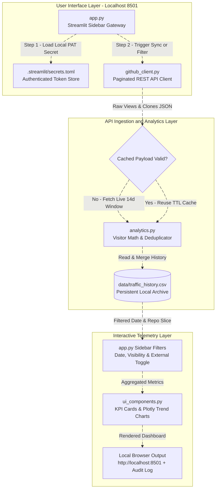

# VCS Metrics Hub

A local web application (`http://localhost:8501`) for aggregating, filtering, and archiving cross-repository traffic and clone telemetry across your version control account using Streamlit, Pandas, Requests, and Plotly.

## About

VCS Metrics Hub provides a lightweight, local-first telemetry pipeline for collecting 14-day page view and Git clone statistics across all owned repositories, isolating external human visitors from owner maintenance, and persisting historical CSV snapshots without external cloud dependencies.

Built and maintained by [T A Srinivas (@SRINIVASTA)](https://github.com), this repository hosts a Streamlit sidebar gateway, a paginated GitHub REST API client, a deduplicating analytics engine with local CSV storage, and interactive Plotly trend visualizations.

## Modules in this repo

| Module | Description |
| :--- | :--- |
| `config.py` | Centralizes API base endpoints (`https://api.github.com`), cache TTL intervals (`3600s`), and HTTP request timeout thresholds. |
| `github_client.py` | Authenticates via Personal Access Token, dynamically resolves the account owner, paginates across all public and private repositories, and fetches 14-day view and clone payloads. |
| `analytics.py` | Transforms raw JSON payloads into structured daily records, calculates owner-excluded visitor counts (`max(0, uniques - 1)`), and merges deduplicated rows into `data/traffic_history.csv`. |
| `ui_components.py` | Renders executive KPI metric cards, multi-repository Plotly line and bar trend tabs, and responsive dark-mode layouts. |

### Architecture & Workflow



### Key Capabilities

* **Cross-Repository Discovery & Visibility Filtering:** Automatically scans all owned public and private repositories without hardcoding usernames, with instant sidebar filtering by visibility (`All`, `Public`, `Private`) or specific project names.
* **Owner-Excluded Visitor Estimation:** Separates routine repository maintenance from genuine outside attention by computing estimated external visitors (`max(0, unique_visitors - 1)`) alongside automated bot clone counts.
* **Persistent Local Historical Archive:** Appends each rolling 14-day API sync into `data/traffic_history.csv` with `(Date, Repository)` deduplication so historical telemetry is preserved permanently on disk.

## Repository Structure

```text
vcs-metrics-hub/
├── .streamlit/
│   ├── config.toml               # Corporate GitHub Dark theme and headless server settings
│   └── secrets.toml              # Local API credentials (GITHUB_TOKEN — ignored by Git)
├── data/
│   └── traffic_history.csv       # Persistent local CSV archive of daily repository telemetry
├── src/
│   ├── __init__.py               # Core telemetry package initializer
│   ├── config.py                 # API endpoint URL, cache TTL, and timeout constants
│   ├── github_client.py          # GitHub REST API wrapper with dynamic owner lookup
│   ├── analytics.py              # Data normalization, external visitor math, and CSV persistence
│   └── ui_components.py          # Executive KPI cards and interactive Plotly trend charts
├── .gitignore                    # Ignores secrets.toml, venv/, __pycache__/, and local CSV logs
├── app.py                        # Main Streamlit web UI with sidebar controls and audit log
├── LICENSE                       # MIT License — Copyright (c) 2026 T A Srinivas
├── requirements.txt              # Python dependencies (streamlit, requests, pandas, plotly)
└── README.md                     # Setup guide, usage instructions, and architecture diagram
```

## Installation & Local Setup

You can clone and run VCS Metrics Hub locally across Windows, macOS, and Linux:

### 1. Clone the repository

```bash
git clone https://github.com/vcs-metrics-hub.git
cd vcs-metrics-hub
```

### 2. Set up Python environment

```bash
# Create virtual environment
python -m venv venv

# Activate on Windows
venv\Scripts\activate

# Activate on macOS / Linux
source venv/bin/activate

# Install dependencies
pip install -r requirements.txt
```

### 3. Configure local API credentials

Create a `.streamlit/secrets.toml` file inside the project root and add your Classic GitHub Personal Access Token (`repo` scope enabled):

```toml
GITHUB_TOKEN = "ghp_your_personal_access_token_here"
```

### 4. Launch the application

```bash
streamlit run app.py
```

Open your browser and navigate to `http://localhost:8501`.

## License

This repository is licensed under the [MIT License](LICENSE) — Copyright (c) 2026 [T A Srinivas](https://github.com).

## Disclaimer

This project is intended for personal repository analytics, portfolio monitoring, and developer telemetry. Users are responsible for securing their Personal Access Tokens locally and adhering to GitHub API rate limits and terms of service.
